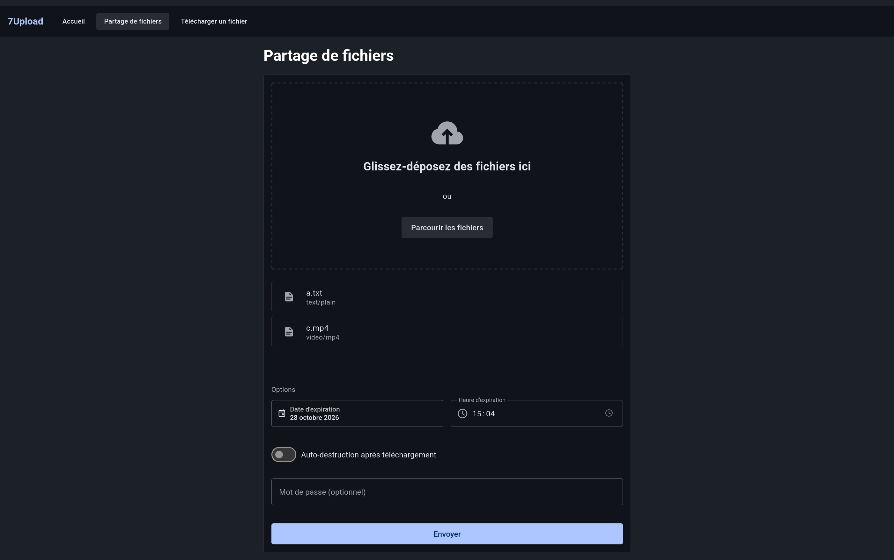

# 7Upload - ENSEEIHT Web development project

7Upload is a file sharing web-based application where you upload and share files with others easily.

## Features

- single file or multi-files uploads
  - qr-code generation for easier file(s) download
  - uploads expiration after a user-provider duration
  - on-server file compression using `node:zlib`
- e2e encryption with user-provided password (using `aes-256-gcm`)
- ephemeral uploads (file gets deleted after download)



## Installation

1. Install pnpm and run:

```bash
pnpm install
```

2. Copy the example env files and configure them as needed.

```bash
cp backend/.env.example backend/.env
cp frontend/.env.example frontend/.env
```

3. Generate the Prisma client:

```bash
pnpm -r db:generate
```

4. Initialize your SQLite database with:

```bash
pnpm -r db:migrate
```

5. Start the app:

```bash
pnpm dev
```
